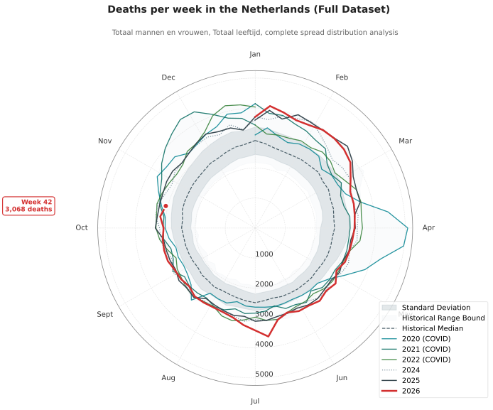

# Overledenen in Nederland / Deaths in the Netherlands

Analysis of data from Centraal Bureau voor de Statistiek Nederland : https://www.cbs.nl

Code: [Overledenen.py](https://github.com/heesters/Oversterfte-Nederland/blob/main/Overledenen.py) (de grafieken worden hiermee automatisch bijgewerkt). Het oorspronkelijke Jupyter Notebook staat in [Overledenen.ipynb](https://github.com/heesters/Oversterfte-Nederland/blob/main/Overledenen.ipynb).

Oversterfte data van Nederland.
Uitdaging zat in het correct weergeven van de eerste en laatste (halve) weken van het jaar, zie [code](https://github.com/heesters/Oversterfte-Nederland/blob/main/Overledenen.py).
Geen correcties voor vergrijzing/bevolkingsgroei etc., ook geen selectie voor covid-19 doden.

De grafieken gebruiken de volledige beschikbare reeks van het CBS (weekcijfers vanaf 1971).
De mediaan, SD en min-max zijn berekend over alle afgeronde jaren, dus inclusief de corona-jaren 2020-2022; alleen het lopende jaar telt niet mee.
